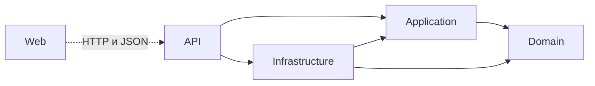

# Архитектура на MovieTracker

> Този материал описва началния етап на проекта. Виж [реализацията за Exercises 02–06](Exercises-02-06.md) за текущия backend и PostgreSQL.

Clean Architecture организира зависимостите около бизнес правилата. Vertical Slice групира кода на една операция според целта му. В MovieTracker проектите определят посоката на зависимостите, а папката `Movies/GetMovieList` събира endpoint, validator, handler и mapping за конкретната операция.



Плътните стрелки са `ProjectReference`. Пунктираната стрелка представя HTTP връзка по време на изпълнение. [API project](../MovieTracker.API/MovieTracker.API.csproj), [Application project](../MovieTracker.Application/MovieTracker.Application.csproj), [Infrastructure project](../MovieTracker.Infrastructure/MovieTracker.Infrastructure.csproj), [Web project](../MovieTracker.Web/MovieTracker.Web.csproj)

| Проект | Роля в Exercise 01 | Компромис и ефект при премахване |
| --- | --- | --- |
| Domain | `Movie.Create` пази правилата за филм. `MovieGenre` задава именуваните жанрове. | В малък скрипт един модел може да стигне. При сливане с HTTP моделите правилата по-лесно се обвързват с транспортния формат. [Movie.cs](../MovieTracker.Domain/Movies/Movie.cs) |
| Application | `GetMovieListHandler` координира извличането и преобразува резултата. Endpoint-ът е в същия slice и Application има framework reference към ASP.NET Core. | Разделяне на HTTP adapter-а в API би намалило тази зависимост, но файловете на операцията биха били в два проекта. При сливане на цялата логика в endpoint-а unit тестът на handler-а губи самостоятелната си граница. [GetMovieList.cs](../MovieTracker.Application/Movies/GetMovieList/GetMovieList.cs), [Endpoint](../MovieTracker.Application/Movies/GetMovieList/GetMovieList.Endpoint.cs) |
| Infrastructure | Конкретното хранилище пази seed филмите в памет и прилага заявката върху тях. | Твърдо зададен списък в handler-а изисква по-малко файлове, но обвързва операцията с един източник. [TestMovieRepository.cs](../tests/MovieTracker.IntegrationTests/Movies/TestMovieRepository.cs) |
| API | Събира реализациите, настройва HTTP pipeline и активира routes. | Без host имаме класове и правила, но HTTP поведението не е достъпно. [Program.cs](../MovieTracker.API/Program.cs) |
| Web | Рендерира страниците в браузъра. Чете JSON чрез свои records. | Споделен DTO проект може да намали дублирането, но синхронизира версиите на клиента и сървъра. Без модели може да четем суров JSON с повече runtime проверки. [MovieListResponseModel.cs](../MovieTracker.Web/Models/Movies/MovieListResponseModel.cs) |

## Dependency inversion и dependency injection

```csharp
builder.Services.AddSingleton<IMovieRepository, InMemoryMovieRepository>();
builder.Services.AddScoped<GetMovieListHandler>();
builder.Services.AddScoped<IValidator<GetMovieListRequest>, GetMovieListValidator>();
```

Dependency inversion е изборът Application да определя интерфейса, а Infrastructure да го реализира. Dependency injection е механизмът, чрез който API предоставя реалния обект. Контейнерът разрешава параметрите на конструктора. Един singleton се споделя в API host-а. Scoped handler и validator се използват в рамките на HTTP request scope. В Web `@inject` взема клиента от клиентския контейнер. При липсваща регистрация framework-ът не може да разреши зависимостта. Ръчното създаване е удобно в unit тест, където има само един handler и един test double. [API Program.cs](../MovieTracker.API/Program.cs), [Web Program.cs](../MovieTracker.Web/Program.cs), [Handler тест](../tests/MovieTracker.UnitTests/Movies/GetMovieList/GetMovieListHandlerTests.cs)

## Граница на текущата реализация

Има два независими източника. API пази 10 сървърни филма, а `DemoData.Movies` е колекция с пет филма в клиента. Бъдеща база би могла да се въведе чрез реализация на `IMovieRepository` и смяна на регистрацията. Схема, миграции, ограничения и автентикация са отделни решения за бъдеща задача. [DemoData.cs](../MovieTracker.Web/Services/Demo/DemoData.cs), [ADR 0001](adr/0001-movie-insights-demo-data.md), [Сигурност](Security-Fundamentals.md)
