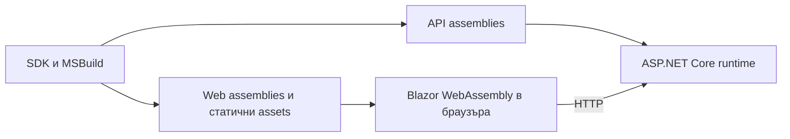

# Основи на .NET

| Концепция | Как работи в MovieTracker | Алтернатива, компромис и ефект при липса |
| --- | --- | --- |
| SDK | Пакет от CLI, компилатор, MSBuild и други инструменти. `dotnet build` оценява конфигурацията и компилира C# до assemblies с IL и metadata. | IDE предлага графичен вход към същия процес. Без SDK може да изпълняваш съвместими готови приложения, но липсва локалната компилация. |
| Runtime | Изпълнява IL чрез подходящ механизъм, управлява паметта и предоставя библиотеки. ASP.NET Core API използва .NET и ASP.NET Core shared frameworks. | Self-contained publish може да включи runtime и увеличава пакета. При обикновено framework-dependent изпълнение липсващ съвместим runtime може да спре API или test host дори след успешен build. |
| Target framework и версия на C# | `net8.0` определя целевите API. `LangVersion` определя позволения синтаксис, тук C# 12. Инсталиран SDK 10 може да компилира този проект за .NET 8. | Смяна на target променя съвместимостта. Без общите настройки всеки проект трябва да получи подходящата конфигурация другаде. |
| Solution и project | `.slnx` групира проектите. Всеки `.csproj` задава своя SDK и зависимости. MSBuild използва `ProjectReference` за реда на компилация и достъпните assemblies. | Може да компилираш отделен project, но solution build проверява едновременно приложението и тестовете. |
| NuGet и restore | Restore разрешава пакетите и транзитивните зависимости за целевия framework. Версиите са централизирани, а проектите изброяват пакетите, които използват. | Версиите могат да са във всеки project, с риск от разминаване. Чист build без restore или готови restore assets може да се провали. |

Източници за настройките. [Directory.Build.props](../Directory.Build.props), [Directory.Packages.props](../Directory.Packages.props), [MovieTracker.slnx](../MovieTracker.slnx), [API project](../MovieTracker.API/MovieTracker.API.csproj), [Web project](../MovieTracker.Web/MovieTracker.Web.csproj)

## Два модела на изпълнение

API използва `WebApplication.CreateBuilder(args)`, регистрира услуги, изгражда ASP.NET Core pipeline и приема HTTP заявки. `MapGet` свързва конкретен HTTP глагол и URL с метод. Controllers са алтернатива при нужда от тяхната организация и инфраструктура. За един route Minimal API държи регистрацията близо до обработката. Без mapping заявката към този път не достига handler-а. [API Program.cs](../MovieTracker.API/Program.cs), [Endpoint](../MovieTracker.Application/Movies/GetMovieList/GetMovieList.Endpoint.cs)

Web използва `WebAssemblyHostBuilder.CreateDefault(args)`. Браузърът зарежда runtime и assets, а Blazor изпълнява компонентите в клиента и обновява DOM при промяна на състоянието. `Add<App>("#app")` посочва кореновия компонент. При Blazor Server компонентите биха се изпълнявали на сървъра с постоянна връзка. WebAssembly пренася изпълнението в браузъра и изисква първоначално изтегляне на клиентските ресурси. Без клиентския host страниците не се стартират. [Web Program.cs](../MovieTracker.Web/Program.cs), [index.html](../MovieTracker.Web/wwwroot/index.html), [App.razor](../MovieTracker.Web/App.razor)

