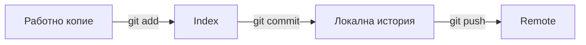

# Git в MovieTracker

Git пази локална история от snapshots. Работното копие са файловете, които редактираш. Index, наричан staging area, пази съдържанието, подготвено за следващия commit. Commit има идентификатор, послание, metadata и указател към родител. Branch е име, което сочи към commit и се премества при нов commit. Remote като `origin` е конфигурирана връзка към друго хранилище.



Можеш да пазиш копия в отделни папки, но Git дава точни сравнения и проследима история на всяка промяна. Един голям commit за цялото упражнение е лесен за създаване, но затруднява прегледа. За курса starter, UI промяната и домашното се поддържат като отделни логически commits. Без staging отделянето на смесени редакции става по-трудно.

## Преглед преди одобрение

```powershell
git status --short
git diff
git diff --check
git log --oneline -5
```

`git diff` по подразбиране показва unstaged промени на проследявани файлове. Новите файлове се виждат като `??` в `git status --short`; отвори ги отделно или ги прегледай след staging чрез `git diff --cached`. `git diff --check` открива определени whitespace проблеми. Командите за commit и push се изпълняват след изрично одобрение.

## Игнорирани файлове и тайни

`.gitignore` пази работното копие от добавяне на локални артефакти като `bin/`, `obj/` и `.env`. Без правилата тези файлове лесно влизат в staging, създават шум и могат да разкрият локални настройки. Ignore правило не премахва вече проследен файл или стойност от историята. При изтекла тайна първо я отмени или смени. [Репозиториен .gitignore](../.gitignore), [Сигурност](Security-Fundamentals.md)
