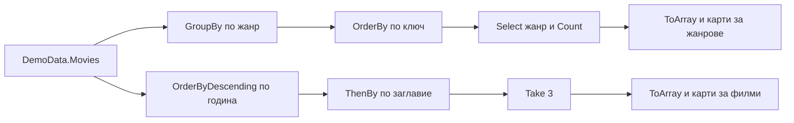

# LINQ и Movie Insights

> Този материал описва началния етап на проекта. Виж [реализацията за Exercises 02–06](Exercises-02-06.md) за текущия backend и PostgreSQL.

LINQ е набор от C# и .NET механизми за заявки върху последователности. Тук методи на `Enumerable` обработват .NET обекти в паметта, като приемат функции за ключове и преобразуване. Алтернатива са `foreach`, речник за броене и ръчен sort. Те дават по-пряк контрол върху обхода, но изискват повече код и внимание към двата критерия за сортиране.



```csharp
private readonly (string Genre, int Count)[] genreCounts = DemoData.Movies
    .GroupBy(movie => movie.Genre)
    .OrderBy(group => group.Key, StringComparer.OrdinalIgnoreCase)
    .Select(group => (Genre: group.Key, Count: group.Count()))
    .ToArray();

private readonly DemoMovie[] newestMovies = DemoData.Movies
    .OrderByDescending(movie => movie.Year)
    .ThenBy(movie => movie.Title, StringComparer.OrdinalIgnoreCase)
    .Take(3)
    .ToArray();
```

Това е кодът в страницата. Двете полета се изчисляват при създаване на компонента, а Razor `foreach` обхожда готовите масиви при рендериране. [MovieInsights.razor](../MovieTracker.Web/Pages/MovieInsights.razor), [DemoData.cs](../MovieTracker.Web/Services/Demo/DemoData.cs)

| Операция | Какво прави тук | Ефект при премахване |
| --- | --- | --- |
| `GroupBy` | Събира елементите в групи по ключ `Genre`, използвайки стандартното равенство за `string`. Групирането буферира данните при обход. | Показването става по филми и губи смисъла на бройката по жанр. |
| `OrderBy` | Подрежда групите по `group.Key`, без да отчита регистъра на буквите. | Групите остават в реда на първото срещане на ключовете в източника. |
| `Select` | Преобразува групата в именувана двойка `(Genre, Count)`. | Razor трябва сам да обработва обектите на групите. |
| `Count()` | Връща броя на елементите в групата. LINQ използва наличен брой, когато източникът го предоставя, иначе обхожда. | Няма стойност за броя филми. |
| `OrderByDescending` | Задава основен ключ `Year`, от най-голям към най-малък. | Първите три следват реда на колекцията, ако липсва сортиране. |
| `ThenBy` | Сравнява заглавията само при равни години. `StringComparer.OrdinalIgnoreCase` осигурява сравнение без регистър и независимо от езиковата култура. | При равни години редът е този на източника. Ново `OrderBy` би направило заглавието основен ключ. |
| `Take(3)` | Ограничава резултата до три елемента. При по-малък източник връща наличните. | Показват се всички сортирани филми. |
| `ToArray()` | Изпълнява веригата и създава масив. Иначе запазен `IEnumerable<T>` би могъл да преизчислява веригата при всеки обход. | Полетата ще изискват друг тип и изчислението ще се отложи до обхода. |

Много LINQ операции са отложени до изброяването. Сортирането и групирането изискват да се разгледа входът, дори когато UI показва само част от резултата. Материализацията заема допълнителна памет, но за пет филма цената е малка. `OrderBy` с игнориране на регистъра не променя равенството в `GroupBy`. Например два жанра, различаващи се само по главни букви, биха останали отделни групи.

## Очакван резултат

- Drama — 1, Science Fiction — 3, Thriller — 1.
- Parasite (2019), Arrival (2016), Interstellar (2014).
- Interstellar и Whiplash са от 2014 г. Interstellar печели по заглавие.

## LINQ в каталога и тестовете

Хранилището използва `OrderBy(...).Skip(skip).Take(take).ToArray()`. `Skip` подминава вече покритите позиции и следва сортирането, за да се определят страниците последователно. Handler-ът използва `Select(...).ToList()` за mapping. `ToList` материализира като списък, докато `ToArray` дава масив. В тестовете `Select` извлича само заглавията или имената на свойствата с грешки, а `All` проверява дали всеки резултат удовлетворява условие. `All` спира при първата неуспешна проверка и връща `true` за празна последователност. [Хранилище](../tests/MovieTracker.IntegrationTests/Movies/TestMovieRepository.cs), [Handler](../MovieTracker.Application/Movies/GetMovieList/GetMovieList.cs), [Validator тестове](../tests/MovieTracker.UnitTests/Movies/GetMovieList/GetMovieListValidatorTests.cs), [Endpoint тестове](../tests/MovieTracker.IntegrationTests/Movies/GetMovieListEndpointTests.cs)
