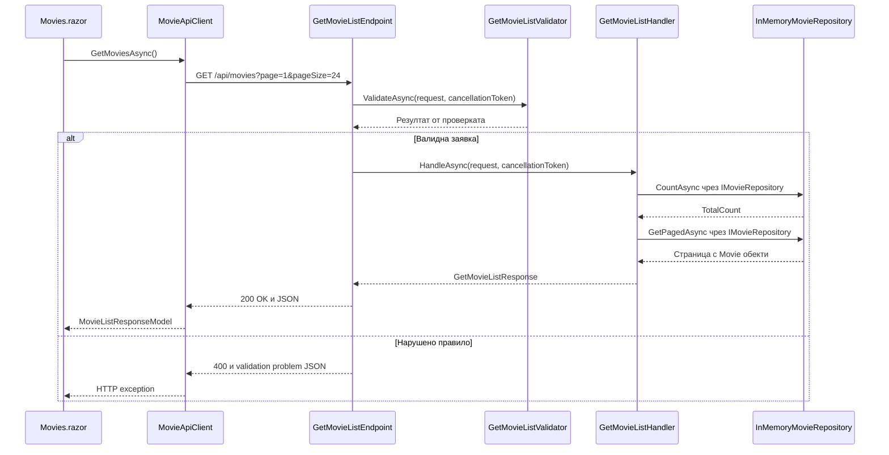

# Жизнен цикъл на GET /api/movies

> Този материал описва началния етап на проекта. Виж [реализацията за Exercises 02–06](Exercises-02-06.md) за текущия backend и PostgreSQL.

1. **Маршрутизиране в браузъра.** `@page "/movies"` свързва маршрута с компонента. `OnInitializedAsync() => LoadMoviesAsync()` стартира зареждането. `LoadMoviesAsync` вдига флага `isLoading` и изчиства старата грешка. При липса на инициализация заявка би имало само при друг потребителски или програмен тригер. [Movies.razor](../MovieTracker.Web/Pages/Movies.razor)
2. **HTTP и JSON.** `GetMoviesAsync(int page = 1, int pageSize = 24, ...)` прави `HttpClient.GetAsync` към относителния път `api/movies`. Базовият адрес идва от клиентския `ApiBaseUrl`. Отделният клиент държи URL и JSON логиката извън Razor markup. Вграждането им в компонента би спестило клас, но би смесило транспорта с UI. [MovieApiClient.cs](../MovieTracker.Web/Services/Movies/MovieApiClient.cs), [Web Program.cs](../MovieTracker.Web/Program.cs), [Web appsettings.json](../MovieTracker.Web/wwwroot/appsettings.json)
3. **Маршрутизиране и binding в ASP.NET Core.** API извиква `app.MapGetMovieListEndpoint()`. `MapGet("/api/movies", HandleAsync)` свързва глагола и пътя. Framework-ът преобразува query параметрите в `int`, разрешава handler и validator чрез DI и предоставя request cancellation token. За липсващи параметри използва `1` и `12`. Невалиден текст вместо число може да бъде отхвърлен при binding, преди FluentValidation. [API Program.cs](../MovieTracker.API/Program.cs), [Endpoint](../MovieTracker.Application/Movies/GetMovieList/GetMovieList.Endpoint.cs)
4. **Валидация.** `GetMovieListEndpoint.HandleAsync` създава `GetMovieListRequest`, изчаква `ValidateAsync` и при нарушение връща `Results.ValidationProblem(validationResult.ToDictionary())`. `Page` трябва да е поне 1, а `PageSize` е между 1 и 50. Ръчни проверки също биха работили, но форматът на грешките трябва да се поддържа изрично. Без правилата размерът и началната позиция могат да са извън договора. [Validator](../MovieTracker.Application/Movies/GetMovieList/GetMovieList.Validation.cs), [Endpoint](../MovieTracker.Application/Movies/GetMovieList/GetMovieList.Endpoint.cs)
5. **Пагинация.** `GetMovieListHandler.HandleAsync` изчислява `skip = (request.Page - 1) * request.PageSize`. Извиква поред `CountAsync` и `GetPagedAsync` през `IMovieRepository`. Конкретният `InMemoryMovieRepository` подрежда по заглавие с `StringComparer.OrdinalIgnoreCase`, пропуска `skip` и взема до `take`. `TotalCount` е броят на цялата колекция. Без `Skip` всяка страница започва от първия филм. Без `Take` няма ограничение на резултатите. Връщането на всичко наведнъж е просто за 10 филма, но не демонстрира сървърна пагинация. [Handler](../MovieTracker.Application/Movies/GetMovieList/GetMovieList.cs), [Интерфейс](../MovieTracker.Application/Common/Repositories/IMovieRepository.cs), [Хранилище](../tests/MovieTracker.IntegrationTests/Movies/TestMovieRepository.cs)
6. **Mapping и сериализация.** `movies.Select(movie => movie.ToResponse()).ToList()` копира публичните полета в `MovieListItemResponse`. `ToResponse` преобразува жанра в текст. `Results.Ok(response)` връща статус 200 и ASP.NET Core сериализира `Items`, `Page`, `PageSize` и `TotalCount` в JSON. Връщането на Domain обекти директно би обвързало публичния договор с вътрешния модел. [Handler](../MovieTracker.Application/Movies/GetMovieList/GetMovieList.cs), [Mapping](../MovieTracker.Application/Movies/GetMovieList/GetMovieList.Mapping.cs)
7. **Обработка в UI.** `EnsureSuccessStatusCode()` превръща неуспешен HTTP статус в exception. При успех `ReadFromJsonAsync<MovieListResponseModel>()` преобразува JSON в клиентския модел. `LoadMoviesAsync` показва грешка при exception и сваля `isLoading` в `finally`. Маркировката показва spinner, грешка с **Try again**, празен каталог или `MovieCard` за всеки елемент. Без `finally` грешка би могла да остави индикатора активен. [MovieApiClient.cs](../MovieTracker.Web/Services/Movies/MovieApiClient.cs), [Movies.razor](../MovieTracker.Web/Pages/Movies.razor), [MovieCard.razor](../MovieTracker.Web/Shared/MovieCard.razor)

## Примери за заявки

| Заявка | Очакван резултат |
| --- | --- |
| `GET /api/movies?page=1&pageSize=3` | `200`, Arrival, Blade Runner 2049 и Inception, с `totalCount: 10`. |
| `GET /api/movies?page=0&pageSize=51` | `400`, грешки за `Page` и `PageSize`. |
| `GET /api/movies` | `200`, страница 1 с размер 12 и 10 налични заглавия. |

Текущият UI иска само първата страница. Правилата допускат много голям `Page`, а `skip` се изчислява с `int`. При достатъчно голяма стойност умножението може да препълни диапазона. Това е ограничение на текущия код. [Validator](../MovieTracker.Application/Movies/GetMovieList/GetMovieList.Validation.cs), [Handler](../MovieTracker.Application/Movies/GetMovieList/GetMovieList.cs), [Endpoint тестове](../tests/MovieTracker.IntegrationTests/Movies/GetMovieListEndpointTests.cs)
